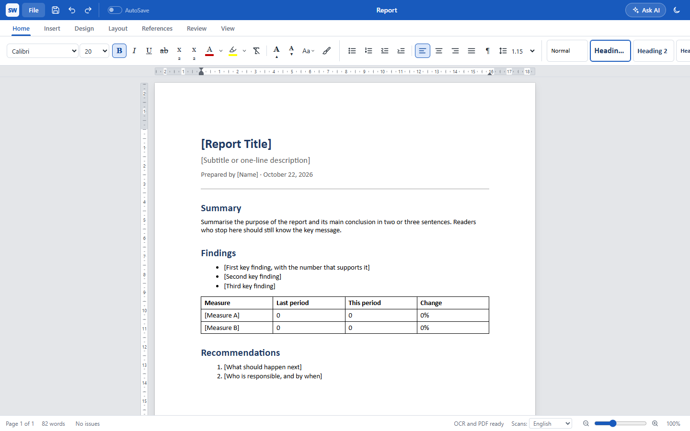

# SPATWORD

A word processor for Windows that opens and saves Word documents, turns PDFs and pictures into
editable Word files, and prints and exports just like Word.

## [⬇ Download SPATWORD for Windows](https://github.com/seme12/docuforge-releases/releases/latest)

On the page that opens, under **Assets**, click **SPATWORD-Setup-…exe**.

## What it does

- **Word documents in and out**: opens Word files and saves real `.docx` files, keeping headings,
  styles, tables, pictures, comments, tracked changes, footnotes, the table of contents and citations.
- **PDF and pictures to Word**: converts PDFs, including scanned ones, and photos of pages into
  editable Word documents. Scans can be read in **English, French, Spanish or Portuguese** (choose in
  the status bar).
- **Everything you'd expect from a word processor**: styles, design themes, page setup, headers and
  footers with page numbers, footnotes at the foot of the page, table of contents, citations and
  bibliography, comments and Track Changes, spelling and grammar checking, and undo for everything.
- **Prints like Word**: File > Print shows the pages exactly as they'll print, with page ranges and
  paper settings. Export to PDF too.
- **Ask AI** (optional): rewrite, summarise, translate or fix grammar with Claude, ChatGPT, Gemini,
  OpenRouter, or a free model running on your own computer (Ollama).
- **Never lose work**: drafts are kept as you type and come back after a crash.

## Install

1. Download **SPATWORD-Setup-…exe** from the [latest release](https://github.com/seme12/docuforge-releases/releases/latest).
2. Run it. Windows may say **"Windows protected your PC"** because the installer isn't signed yet:
   click **More info**, then **Run anyway**.
3. Follow the steps. No administrator rights are needed, and you can choose to add a desktop
   shortcut and "Open with SPATWORD" for Word and PDF files.

**Needs:** Windows 10 or 11 (64-bit). The Microsoft Edge WebView2 runtime it uses comes with Windows;
Setup tells you if it's missing. **Exporting to PDF**, and opening older `.doc`, `.odt` and `.rtf`
files, also need either [LibreOffice](https://www.libreoffice.org) (free) or Microsoft Word on the
same computer. Everything else works on its own.

## Updates

SPATWORD checks for a new version a few seconds after it starts (and from **File > Check for
updates**). When one is out it offers **Install now**: it downloads the new version from this page,
checks it against the checksum published with it (so a damaged or altered download isn't installed),
and restarts itself.

## Your documents stay yours

Documents are opened, converted and saved on your own computer; nothing is uploaded anywhere. Only
**Ask AI** sends text out, and only the text you ask about, to the AI service you set up with your
own key (or to Ollama on your own computer).

## Uninstall

**Settings > Apps > Installed apps > SPATWORD > Uninstall.**

---

SPATWORD was first released as DocuForge; copies installed under that name update to SPATWORD by
themselves.
